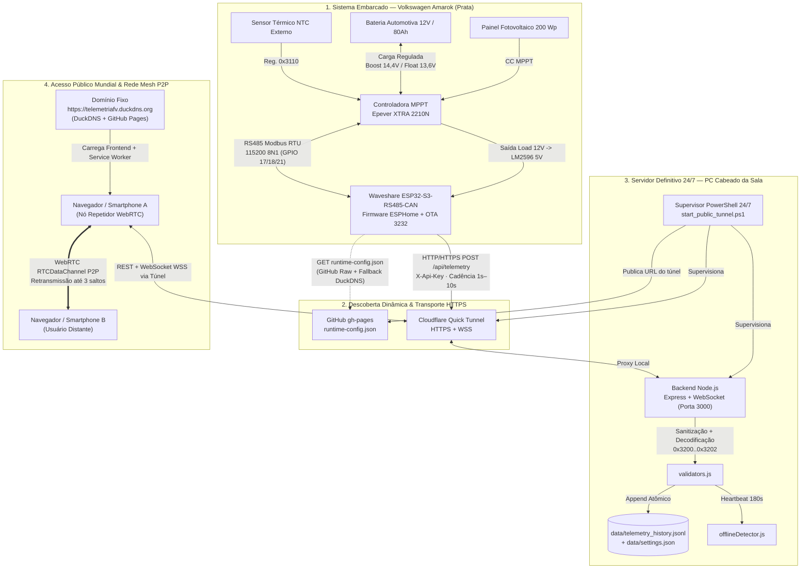

# Arquitetura Completa do Sistema de Telemetria Fotovoltaica Automotiva

Este documento detalha toda a arquitetura de hardware, firmware, redes, backend, persistência e interface web desenvolvida para o **Trabalho de Conclusão de Curso (TCC) no SENAI**, implantado em operação real em uma **Volkswagen Amarok (Prata)** equipada com sistema fotovoltaico automotivo (`200 Wp` / `12 V` / `80 Ah`).

---

## 1. Visão Geral das 5 Camadas do Sistema

O sistema foi projetado de ponta a ponta em cinco camadas desacopladas e resilientes:

1. **Camada 1 — Aquisição Embarcada no Veículo (Hardware & Firmware)**:
   - Módulo fotovoltaico de **`200 Wp`** conectado à controladora MPPT **Epever XTRA 2210N** (calibrada para perfil automotivo `12 V / 80 Ah`).
   - Leitura contínua via barramento industrial **RS485 Modbus RTU (`115200 bps`, `8N1`, endereço escravo `0x01`)** por uma placa **Waveshare ESP32-S3-RS485-CAN** executando **ESPHome (ESP-IDF 5.5)**.
   - Alimentação autônoma do ESP32-S3 a partir da porta `Load` da controladora com conversor DC-DC Step-Down **LM2596** regulado em `5,0 V`.
2. **Camada 2 — Conectividade Multi-Wi-Fi e Descoberta Instantânea de Endpoint**:
   - O ESP32-S3 gerencia uma lista priorizada de redes Wi-Fi (rede institucional WPA2 + hotspot móvel de contingência em prioridade máxima), com reconexão automática, OTA criptografado sem fio na porta `3232` e Access Point de contingência (*Fallback AP*).
   - Para permitir comunicação mesmo quando o veículo e o servidor estão em **redes físicas completamente diferentes** (ex.: Amarok no Wi-Fi do pátio e servidor no PC cabeado da sala de aula), o ESP32-S3 descobre dinamicamente o túnel HTTPS ativo consultando `https://raw.githubusercontent.com/felipemmattia/sistema-fotovoltaico-automotivo/gh-pages/runtime-config.json?_=<millis>` (com fallback automático em `https://telemetriafv.duckdns.org/runtime-config.json`).
3. **Camada 3 — Servidor Definitivo Portátil 24/7 e Domínio Fixo Gratuito**:
   - Executado no computador cabeado da sala de aula via [`iniciar_servidor_24_7.bat`](../iniciar_servidor_24_7.bat) e [`scripts/start_public_tunnel.ps1`](../scripts/start_public_tunnel.ps1), **sem exigir Docker, `winget` ou permissão de Administrador**.
   - Auto-provisiona **Node.js portátil**, **GitHub CLI (`gh`) portátil** e **`cloudflared`**, cria túnel HTTPS seguro (`trycloudflare.com`), sincroniza automaticamente o arquivo `runtime-config.json` na branch `gh-pages` e registra inicialização silenciosa no Windows (`Startup`).
   - O domínio fixo **`https://telemetriafv.duckdns.org`** (DuckDNS apontado para o GitHub Pages `185.199.108.153` com HTTPS forçado) serve o frontend estático mundialmente e resolve dinamicamente o backend ativo.
4. **Camada 4 — Ingestão, Diagnóstico Modbus, Fallback Local e Persistência (Backend)**:
   - Servidor **Node.js + Express + WebSocket (`ws`)** em [`dashboard/backend/server.js`](../dashboard/backend/server.js).
   - Sanitiza e valida todas as leituras ([`validators.js`](../dashboard/backend/validators.js)), decodifica os registradores de falha/estágio (`0x3200`–`0x3202`), supervisiona timeout de comunicação de 180 segundos ([`offlineDetector.js`](../dashboard/backend/offlineDetector.js)), calcula cadência adaptativa por RSSI/espectadores e persiste cada pacote de forma atômica em **Write-Ahead Log (`telemetry_history.jsonl`)** ([`database.js`](../dashboard/backend/database.js)).
   - Inclui ainda um **coletor automático em rede local (`pollDiscoveredEsp32`)** que entra em ação como fallback caso o servidor e o ESP32 estejam na mesma sub-rede e não haja envio HTTP POST direto por mais de 15 s.
5. **Camada 5 — Dashboard Web Interativo 3D e Rede Mesh Cooperativa P2P (Frontend)**:
   - Interface responsiva em tema claro e escuro ([`index.html`](../dashboard/frontend/index.html), [`css/style.css`](../dashboard/frontend/css/style.css), [`js/app.js`](../dashboard/frontend/js/app.js)) com **Service Worker Offline-First** ([`sw.js`](../dashboard/frontend/sw.js)).
   - Modelos 3D fisicamente baseados em **WebGL PBR (Smith-GGX)** ([`js/models3d.js`](../dashboard/frontend/js/models3d.js)), gráfico histórico interativo em **Chart.js** ([`js/charts.js`](../dashboard/frontend/js/charts.js)) e retransmissão cooperativa multi-salto entre navegadores via **WebRTC DataChannel** ([`js/mesh.js`](../dashboard/frontend/js/mesh.js)).

---

## 2. Diagrama de Arquitetura e Fluxo de Dados Completo

---

## 3. Mapa Completo de Registradores Modbus RTU (Epever XTRA 2210N)

### 3.1 Registradores de Leitura em Tempo Real (Função `0x04` — Read Input Registers)

Lidos pelo firmware [`esphome/epever_solar_esp32s3.yaml`](../esphome/epever_solar_esp32s3.yaml) com intervalo de aquisição de `1 s` no barramento RS485 (`turnaround_time: 20ms`):

| Endereço | Sensor no Firmware | Tipo / Escala | Faixa de Clamping | Descrição Técnica |
| :---: | :--- | :---: | :---: | :--- |
| `0x3100` | `pv_voltage` | `U_WORD` ($\div 100$) | `0,0 – 120,0 V` | Tensão de entrada do arranjo fotovoltaico |
| `0x3101` | `pv_current` | `U_WORD` ($\div 100$) | `0,0 – 30,0 A` | Corrente de entrada do painel solar |
| `0x3102` | `pv_power` | `U_DWORD_R` ($\div 100$) | `0,0 – 1000,0 W` | Potência instantânea gerada (32 bits, word-swapped) |
| `0x3104` | `battery_voltage` | `U_WORD` ($\div 100$) | `0,0 – 36,0 V` | Tensão medida nos terminais da bateria |
| `0x3105` | `battery_current` | `U_WORD` ($\div 100$) | `0,0 – 30,0 A` | Corrente de carregamento entregue à bateria |
| `0x3106` | `battery_power` | `U_DWORD_R` ($\div 100$) | `0,0 – 1000,0 W` | Potência efetiva entregue à bateria |
| `0x3110` | `external_temp` | `S_WORD` ($\div 100$) | `-40,0 – 85,0 °C` | Temperatura real da bateria via sonda NTC externa |
| `0x311A` | `battery_soc` | `U_WORD` ($1\times$) | `0 – 100 %` | Estado de carga estimado pela controladora (SOC) |
| `0x311B` | `controller_temp` | `S_WORD` ($\div 100$) | `-40,0 – 85,0 °C` | Temperatura remota complementar da bateria (RTS) |
| `0x3200` | `battery_status_reg` | `U_WORD` (Bitmask) | `0 – 65535` | Alarmes de tensão, temperatura, resistência interna e sistema |
| `0x3201` | `charging_status_reg` | `U_WORD` (Bitmask) | `0 – 65535` | Estágio MPPT (Float/Boost/Equalize), falhas de MOSFET e FV |
| `0x3202` | `discharging_status_reg` | `U_WORD` (Bitmask) | `0 – 65535` | Curto-circuito, sobrecorrente e falhas no estágio de saída |
| `0x330C` | `energy_today` | `U_DWORD_R` ($\div 100$) | `>= 0,0 kWh` | Energia acumulada gerada no dia corrente |
| `0x3312` | `energy_total` | `U_DWORD_R` ($\div 100$) | `>= 0,0 kWh` | Energia acumulada total histórica |

### 3.2 Registradores de Configuração Automotiva (Funções `0x03`, `0x10` e `0x05`)

Gravados na EEPROM da Epever via [`scripts/configure_epever_automotive.ps1`](../scripts/configure_epever_automotive.ps1) (detalhamento completo em [HARDWARE_WIRING.md](HARDWARE_WIRING.md)):
- **`0x9000`–`0x900E`**: Bloco de 15 parâmetros do perfil `User-Defined` para bateria automotiva `12 V / 80 Ah` (`Boost 14,40 V`, `Float 13,60 V`, `LVR 12,20 V`, `LVD 11,10 V`).
- **`0x9067 = 1`**: Travamento da tensão nominal do sistema em `12 V` fixo.
- **`0x906B = 0`**: Duração de equalização zerada (`0 min`, obrigatória para baterias automotivas seladas).
- **`0x903D = 0` e `0x906A = 1`**: Modo Manual da saída `Load` com estado padrão **Ligado ao energizar**.
- **Coils `0x0000`, `0x0001`, `0x0002`**: Habilitação de carregamento, modo manual e acionamento imediato da saída `Load`.

---

## 4. API HTTP REST e Protocolo WebSocket (`dashboard/backend/server.js`)

### 4.1 Endpoints REST

| Método | Rota | Autenticação | Função |
| :---: | :--- | :---: | :--- |
| `POST` | `/api/telemetry` | `X-Api-Key` (opcional/configurável) | Ingestão direta enviada pelo ESP32-S3. Retorna `{ success, next_interval_ms }` para controle adaptativo de cadência. |
| `POST` | `/api/telemetry/uplink` | `X-Api-Key` (opcional) | Ingestão alternativa via ponte P2P Mesh (*Uplink Bridge*) quando um navegador próximo repassa pacotes ao servidor. |
| `GET` | `/api/telemetry/latest` | Pública | Retorna a última leitura válida (ou `data: null` quando `offline`), nome do veículo, `status` de heartbeat e quantidade de nós Mesh. |
| `GET` | `/api/telemetry/history?period=` | Pública | Retorna histórico agregado: `hours` (24 h, buckets de 1 min), `days` (7 d, buckets de 10 min) ou `weeks` (30 d, buckets de 30 min). |
| `GET` | `/api/settings` | Pública | Retorna as configurações do veículo (`vehicle_name`, `system_voltage`, `battery_capacity_ah`, `solar_kwp`). |
| `POST` | `/api/settings` | Pública | Atualiza e persiste `data/settings.json`, transmitindo o evento `SETTINGS_UPDATED` a todos os clientes via WebSocket. |
| `GET` | `/api/health` | Pública | Endpoint de saúde utilizado pelo supervisor do túnel (`status: "UP"`, `uptime_seconds`, `offline_detector`, `mesh_nodes`). |

### 4.2 Eventos WebSocket (`ws://` / `wss://`)

- **Servidor → Clientes**:
  - `TELEMETRY_UPDATE`: envia em tempo real cada pacote validado (com `controller_errors` e `charging_stage` já decodificados).
  - `STATUS_CHANGE`: notifica transição imediata entre `online` e `offline` (resetando a interface para `—` quando `offline`).
  - `SETTINGS_UPDATED`: sincroniza alterações de parâmetros do veículo entre todas as abas/dispositivos abertos.
  - `MESH_PEERS` / `MESH_SIGNAL`: sinalização SDP/ICE para estabelecimento de conexões diretas **WebRTC `RTCDataChannel`**.
- **Clientes → Servidor**:
  - `MESH_SIGNAL`: troca de ofertas/respostas ICE entre navegadores.
  - `MESH_UPLINK_INGEST`: envio de pacotes coletados localmente por um navegador ponte.

---

## 5. Cadência Adaptativa por Proximidade Wi-Fi (RSSI) e Presença de Usuários

O servidor calcula dinamicamente o campo `next_interval_ms` devolvido na resposta HTTP `200` para o ESP32-S3:

| Condição | Intervalo de Envio (`target_interval_ms`) | Objetivo |
| :--- | :---: | :--- |
| Nenhum espectador conectado (`activeClients === 0`) | **`10.000 ms` (10 s)** | Economia de banda, CPU e energia da bateria |
| Espectadores ativos + Sinal Wi-Fi Forte (`RSSI >= -55 dBm`) | **`1.000 ms` (1 s)** | Máxima fluidez em demonstrações e testes próximos |
| Espectadores ativos + Sinal Wi-Fi Médio (`-70 <= RSSI < -55 dBm`) | **`2.000 ms` (2 s)** | Equilíbrio entre fluidez e estabilidade |
| Espectadores ativos + Sinal Wi-Fi Fraco (`RSSI < -70 dBm`) | **`5.000 ms` (5 s)** | Redução de perda de pacotes a longa distância |

---

## 6. Persistência de Dados (`dashboard/backend/database.js`)

- **Formato Write-Ahead Log (WAL)**: cada pacote validado é anexado atomicamente com `fs.appendFileSync` como uma linha JSON em `dashboard/backend/data/telemetry_history.jsonl` (ignorado pelo Git para não inflar o repositório).
- **Índice em Memória**: ao iniciar, o servidor carrega até os últimos **50.000 registros** em `memoryCache`, ignorando automaticamente eventuais linhas truncadas por falta de energia abrupta.
- **Agregação Histórica**: `getHistory(period)` agrupa os registros em janelas fixas de `60 s` (24 h), `600 s` (7 dias) ou `1.800 s` (30 dias), garantindo renderização rápida do gráfico sem sobrecarregar dispositivos móveis.
