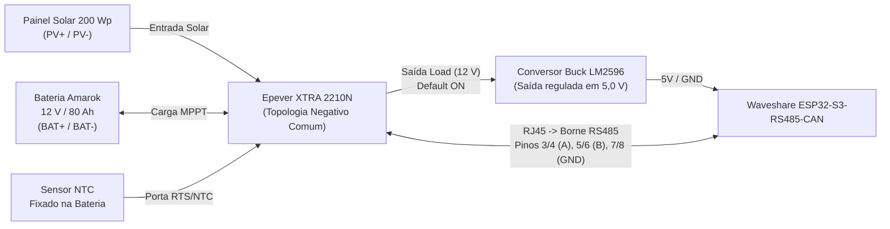

# Hardware, Esquema Elétrico, Pinagem e Calibração Automotiva

Este documento descreve integralmente todo o hardware instalado na **Volkswagen Amarok (Prata)**, as ligações físicas entre os módulos, os cuidados de segurança elétrica e a calibração automotiva gravada na controladora **Epever XTRA 2210N**.

---

## 1. Lista Completa de Componentes Utilizados (BOM)

| Componente | Especificação / Modelo | Função no Projeto |
| :--- | :--- | :--- |
| **Veículo de Aplicação** | **Volkswagen Amarok (Prata)** | Plataforma automotiva real com sistema elétrico `12 V` |
| **Bateria Automotiva** | Chumbo-ácido automotiva selada `12 V / 80 Ah` | Armazenamento de energia recarregada pelo sistema FV |
| **Módulo Fotovoltaico** | Painel solar `200 Wp` (tensão operacional MPPT ~`27–31 V`) | Captação solar instalada sobre o veículo |
| **Controladora Solar** | **Epever XTRA 2210N** (`20 A`, `12/24 V`, até `100 V` FV, MPPT) | Rastreamento de ponto de máxima potência, proteção da bateria e interface Modbus RS485 |
| **Microcontrolador / Ponte IoT** | **Waveshare ESP32-S3-RS485-CAN** (16 MB Flash, 8 MB PSRAM, USB-C) | Leitura Modbus RTU via RS485 embarcado, Wi-Fi Multi-Rede, OTA sem fio e envio HTTPS |
| **Conversor DC-DC** | Módulo Step-Down (Buck) **LM2596** ajustado para `5,0 V` | Redução estável da saída `Load` (`12 V`) da Epever para alimentação do ESP32-S3 (`5 V`) |
| **Sensor de Temperatura** | Termistor **NTC externo** conectado à porta dedicada da Epever | Medição térmica real da bateria (`0x3110`) e compensação térmica de carga (`-3 mV/°C/2V`) |
| **Barramento de Comunicação** | Cabo par trançado com conector **RJ45** (8 vias) | Interligação diferencial RS485 (`A`, `B`, `GND`) entre Epever e Waveshare ESP32-S3 |
| **Servidor 24/7 Definitivo** | Computador desktop cabeado da sala de aula (SENAI) | Hospedagem local do backend Node.js + túnel Cloudflare para `https://telemetriafv.duckdns.org` |

---

## 2. Esquema Elétrico e Fluxo de Energia

> [!IMPORTANT]
> **Topologia Negativo Comum (*Common Negative*):** A família **Epever XTRA N** compartilha o negativo comum entre `PV-`, `BAT-` e `LOAD-`. Garantir firmeza mecânica nos bornes e integridade contínua do condutor negativo comum é essencial: qualquer interrupção no fio negativo em comum derruba simultaneamente a referência do barramento e a alimentação do módulo ESP32-S3.

---

## 3. Pinagem do Conector RJ45 (Epever XTRA 2210N → Waveshare ESP32-S3)

A porta RS485 da controladora Epever XTRA 2210N utiliza conector RJ45 de 8 pinos com a seguinte correspondência:

| Pino RJ45 Epever | Sinal / Função | Descrição | Ligação na Waveshare ESP32-S3-RS485-CAN |
| :---: | :--- | :--- | :--- |
| **Pino 1** | `+5V DC` | Alimentação auxiliar limitada (`<= 50 mA`) | **Não conectar** (insuficiente para picos de Wi-Fi do ESP32-S3) |
| **Pino 2** | `+5V DC` | Alimentação auxiliar limitada (`<= 50 mA`) | **Não conectar** |
| **Pino 3** | **RS485-A** | Linha diferencial positiva (`D+`) | Borne **RS485 A** |
| **Pino 4** | **RS485-A** | Linha diferencial positiva (`D+`) | Borne **RS485 A** (em paralelo ao Pino 3) |
| **Pino 5** | **RS485-B** | Linha diferencial negativa (`D-`) | Borne **RS485 B** |
| **Pino 6** | **RS485-B** | Linha diferencial negativa (`D-`) | Borne **RS485 B** (em paralelo ao Pino 5) |
| **Pino 7** | **GND** | Referência de terra do barramento RS485 | Borne **GND** |
| **Pino 8** | **GND** | Referência de terra do barramento RS485 | Borne **GND** (em paralelo ao Pino 7) |

### Pinagem Interna da Placa Waveshare ESP32-S3-RS485-CAN

Mapeada no firmware [`esphome/epever_solar_esp32s3.yaml`](../esphome/epever_solar_esp32s3.yaml#L77-L98):

| Parâmetro ESPHome | GPIO ESP32-S3 | Função |
| :--- | :---: | :--- |
| `uart.tx_pin` | **`GPIO 17`** | Transmissão UART (`DI`) para o transceptor RS485 integrado |
| `uart.rx_pin` | **`GPIO 18`** | Recepção UART (`RO`) do transceptor RS485 integrado |
| `uart.flow_control_pin` | **`GPIO 21`** | Controle automático de direção Half-Duplex (`DE` / $\overline{\text{RE}}$) |
| Parâmetros seriais | — | `115200 bps`, `8` bits, sem paridade (`NONE`), `1` stop bit (`8N1`), Slave ID `0x01` |

---

## 4. Calibração Automotiva da Controladora Epever XTRA 2210N

A configuração de fábrica da Epever XTRA 2210N é voltada para baterias estacionárias genéricas (com equalização ativa e limites de desconexão inadequados para uma bateria automotiva de partida). Para adequar o sistema à **Volkswagen Amarok (`12 V / 80 Ah`)** e garantir que a saída `Load` mantenha o ESP32-S3 energizado automaticamente, foi desenvolvido e executado via adaptador USB-RS485 (`COM3`) o script [`scripts/configure_epever_automotive.ps1`](../scripts/configure_epever_automotive.ps1).

### Tabela Completa de Parâmetros Gravados na EEPROM via Modbus RTU

| Registrador | Parâmetro | Valor Gravado | Justificativa Automotiva |
| :---: | :--- | :---: | :--- |
| `0x9000` | Tipo de Bateria | `0` (**User-Defined**) | Habilita ajuste fino seguro de todas as tensões para bateria automotiva selada |
| `0x9001` | Capacidade Nominal | **`80 Ah`** | Capacidade real da bateria instalada na Volkswagen Amarok |
| `0x9002` | Coeficiente de Compensação Térmica | **`3,00 mV/°C/2V`** | Ajusta tensão de carga conforme temperatura real medida pelo sensor NTC |
| `0x9003` | High Voltage Disconnect (HVD) | **`16,00 V`** | Proteção contra sobretensão severa |
| `0x9004` | Charging Limit Voltage | **`15,00 V`** | Limite superior seguro de carregamento |
| `0x9005` | Over Voltage Reconnect (OVR) | **`15,00 V`** | Reconexão após evento de sobretensão |
| `0x9006` | Equalization Voltage | **`14,40 V`** | Igualado ao Boost (com duração `0 min`, sem gaseificação) |
| `0x9007` | Boost Charging Voltage | **`14,40 V`** | Tensão ideal de absorção até 100%, compatível com o alternador automotivo |
| `0x9008` | Float Charging Voltage | **`13,60 V`** | Manutenção em flutuação sem sobrecarga contínua da bateria |
| `0x9009` | Boost Reconnect Voltage | **`13,20 V`** | Retoma ciclo Boost quando a bateria sofrer descarga relevante |
| `0x900A` | Low Voltage Reconnect (LVR) | **`12,20 V`** | Religa rapidamente a porta `Load` (ESP32-S3) assim que a bateria recupera tensão |
| `0x900B` | Under Voltage Recover (UVR) | **`12,00 V`** | Encerra alerta de subtensão ao atingir 12,0 V |
| `0x900C` | Under Voltage Warning (UVW) | **`11,80 V`** | Dispara aviso antecipado antes da descarga crítica |
| `0x900D` | Low Voltage Disconnect (LVD) | **`11,10 V`** | Corta saída `Load` para preservar reserva mínima de partida do motor |
| `0x900E` | Discharging Limit Voltage | **`10,60 V`** | Limite inferior absoluto de descarga |
| `0x9067` | Rated System Voltage | `1` (**`12 V` fixo**) | Evita detecção incorreta de 24 V em caso de picos transitórios |
| `0x906B` | Equalize Duration | **`0 min`** | Desabilita equalização (obrigatório em baterias automotivas seladas/EFB/AGM) |
| `0x903D` | Load Control Mode | `0` (**Manual**) | Permite controle direto da saída `Load` pelo painel ou Modbus |
| `0x906A` | Default Load ON (Manual) | `1` (**Ligada ao iniciar**) | Garante que o ESP32-S3 ligue sozinho sempre que a controladora energizar |
| Coils `0x0000`–`0x0002` | Carga ON / Manual / Load ON | `true / true / true` | Ativa imediatamente o estágio de carregamento e a porta `Load` |

---

## 5. Segurança Elétrica na Manutenção e Gravação USB-C

> [!CAUTION]
> **Nunca conecte o cabo USB-C do notebook ao ESP32-S3 enquanto o conversor LM2596 / saída `Load` estiverem energizando a placa.**

1. **Risco de conflito de 5 V (*backfeed*):** diferenças mínimas entre o regulador LM2596 (ex.: `5,2 V`) e a porta USB do notebook (`5,0 V`) podem provocar retorno de corrente e danificar a porta USB ou o regulador.
2. **Risco de loop de terra:** se o notebook estiver na tomada elétrica (AC), a referência de terra do carregador pode diferir do chassi 12 V do veículo.
3. **Procedimento seguro para gravação via USB-C** (quando não for possível usar OTA sem fio):
   - Desligue a alimentação do ESP32-S3 (toque curto no botão `LOAD` da Epever fora de menus, ou desconecte apenas o fio positivo `+` que sai do LM2596 para o ESP32-S3) e confirme visualmente que os LEDs apagaram.
   - Os fios diferenciais do RS485 (`A`, `B`, `GND`) podem permanecer conectados.
   - Mantenha o notebook **fora da tomada (somente na bateria)**.
   - Conecte o USB-C, grave o firmware, desconecte o USB-C e somente depois religue a alimentação externa do ESP32-S3.

---

## 6. Comportamento Real Validado em Campo (Oficina vs. Pátio Externo)

- **Em oficina fechada sob lâmpadas LED:** é comportamento fisicamente normal o painel exibir tensão de circuito aberto aparente (ex.: `12–20 V`) com **corrente e potência iguais a `0,00 A / 0,00 W`**. Iluminação artificial interna fornece irradiância dezenas de vezes menor que a luz solar e espectro limitado, insuficientes para o MPPT superar a tensão da bateria e injetar corrente.
- **Em pátio externo sob incidência solar:** em testes reais com a Amarok estacionada no pátio, a controladora entrou imediatamente em estágio **`Boost (Absorção)`**, operando em ~`27–31 V` no painel e injetando **`+2,0 A` a `+3,7 A`** (`26–49 W` em sol parcial de final de tarde), elevando a bateria de `12,35 V` para `12,99 V` e registrando geração diária (`0,08` → `0,11 kWh`) em tempo real no site.
